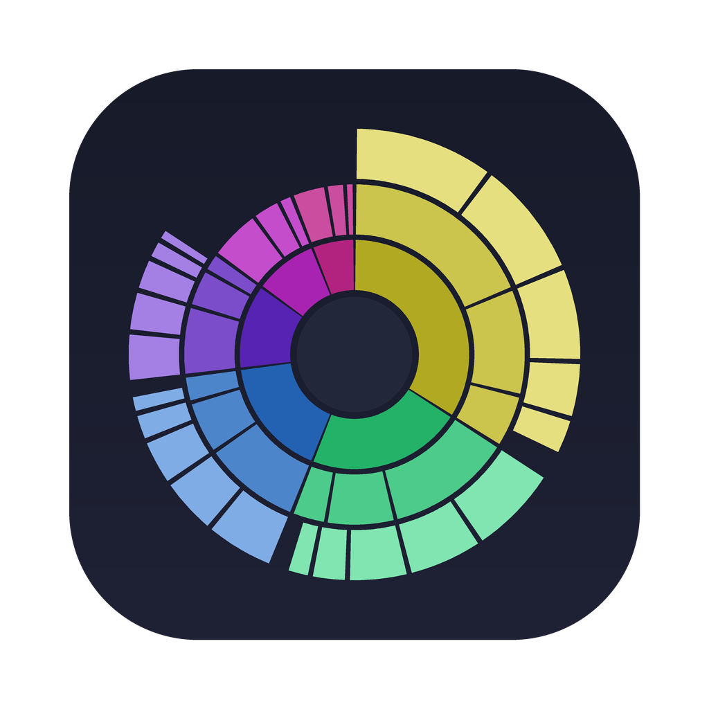

<p align="center"></p>

# DiskLens

A free, open-source, native macOS app for seeing what's using your disk and clearing it safely. Written in SwiftUI, no dependencies.

## Features

- **Disk map.** An interactive sunburst of any volume or folder. Hover to inspect, click a ring to zoom in, click the centre to go up.
- **Fast scanning.** Uses `getattrlistbulk` with a pool of worker threads: a full ~800 GB startup disk with 10 million files scans in about 3 minutes on Apple silicon. Hard links are counted once, and cloud placeholders (iCloud, Google Drive, Dropbox) are never downloaded.
- **Risk levels.** Every file and folder gets a rating with a plain-English reason:

  | Level | Meaning | Examples |
  |---|---|---|
  | Safe | Rebuilt automatically, nothing is lost | `~/Library/Caches`, Xcode DerivedData, pip/uv caches, logs |
  | Safe · re-downloads | Comes back, but costs time and bandwidth | `~/.cache`, Hugging Face models, `node_modules`, Gradle |
  | Review first | Could be something you want | Downloads, installers, VMs, Ollama models, Docker data |
  | Unknown | No rule yet | Your own folders |
  | High risk | Don't delete from here | Application Support, Mail, iCloud Drive, Photos library, `.ssh`, `.git` |

- **Collector.** Drag items from the map or list into the bar at the bottom, check the total and any risk warnings, then move them to the Trash or delete them permanently.
- **System-owned items.** Folders installed with admin rights (e.g. by an installer in `/Applications`) can be removed through the standard macOS password prompt. High-risk items never get this option.
- **Quick Clean.** One-click clearing of user caches, logs, Xcode DerivedData / DeviceSupport / simulator caches, npm / Bun / Gradle / CocoaPods caches, old Downloads and the Trash.

Nothing is deleted without confirmation, and by default everything goes to the Trash so you can undo it.

## Build and install

Requirements: macOS 14 or later and Apple's command line tools (`xcode-select --install`). Xcode itself isn't needed.

```bash
git clone https://github.com/OJ-Labs-Ltd/disklens.git
cd disklens
./build.sh --install     # builds, copies to /Applications and launches
```

`./build.sh` on its own leaves the app in `build/DiskLens.app`. After pulling changes, double-click **Update DiskLens.command** to rebuild and reinstall.

The app is ad-hoc signed for local use; it isn't notarised.

## First run

Give DiskLens **Full Disk Access** (System Settings › Privacy & Security › Full Disk Access), then reopen it. Without it, macOS hides Mail, Messages, Safari data, the Trash and other protected folders, and their space is reported as "not visible". You may need to grant it again after a rebuild.

## Notes

- Sizes are allocated (on-disk) sizes, like Finder's "size on disk".
- When scanning the startup disk, the other APFS volumes under `/System/Volumes` are skipped because their contents already appear through `/Users`, `/Applications`, etc. Local Time Machine snapshots and purgeable space are managed by macOS and show as "not visible".
- APFS clones share blocks, so deleting a cloned file can free less than its listed size.
- Risk levels are rules of thumb, not guarantees. If something important is rated wrongly, please open an issue or a pull request against `Sources/DiskLens/Model/Risk.swift`.

## Project layout

```
Sources/DiskLens/
  DiskLensApp.swift           app entry, menus, theme
  Model/FileNode.swift        tree node (size, children, path)
  Model/DiskScanner.swift     getattrlistbulk scanner, volume list
  Model/SunburstLayout.swift  ring/segment layout
  Model/Risk.swift            risk rules and badges
  Model/AppState.swift        navigation, collector, deletion
  Model/Cleaner.swift         Quick Clean categories
  Views/                      Home, Scanning, Results, Quick Clean
Resources/                    Info.plist, icon
build.sh                      compile, assemble and sign the .app
```

## Licence

MIT. See [LICENSE](LICENSE).
